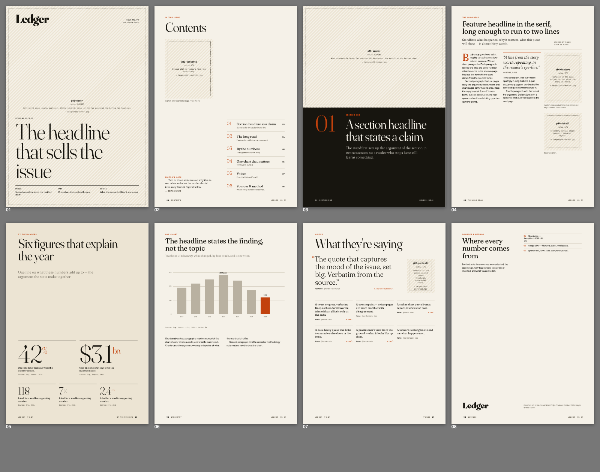

# Report Studio

Magazine-style reports, made by Claude, from real sources:

- **Websites & PDF reports**: fetched, text-extracted, cited by page
- **Google Drive**: searched, inventoried, read (via the Google Drive connector)
- **Twitter/X**: search, timelines, threads via [Agent Reach](https://github.com/Panniantong/Agent-Reach) + twitter-cli, with a no-login fallback for single tweets
- **Design**: an editorial A4 template (cover, contents, openers, features, numbers, charts, voices, sources) with **named image slots**, so you always know where each picture goes. Bundled design skills keep the result away from generic "AI layout" looks.

Output: `report.pdf`, `report.html`, page previews, and a table of image slots.



## What's inside

| Skill | Source | Role |
|---|---|---|
| `magazine-report` | this repo | The pipeline: gather → brief → design → render |
| `agent-reach` | [Panniantong/Agent-Reach](https://github.com/Panniantong/Agent-Reach) (MIT) | Twitter/X, Reddit, YouTube, LinkedIn, RSS, web, Exa search |
| `impeccable` | [pbakaus/impeccable](https://github.com/pbakaus/impeccable) (Apache-2.0) | Design critique, typesetting, polish passes |
| `design-taste-frontend` | [Leonxlnx/taste-skill](https://github.com/Leonxlnx/taste-skill) (MIT) | Anti-slop rules, type/colour library |
| `frontend-design` | [anthropics/skills](https://github.com/anthropics/skills) (Apache-2.0) | Anthropic's design skill |

### Slash commands

| Command | What it does |
|---|---|
| `/report <topic> [urls] [drive names] [@handles]` | Full issue → PDF |
| `/report-brief <topic> …` | Gather sources and brief you on them. No design. |
| `/drive-scan <topic or folder>` | What's in your Drive on this, as a table |
| `/tweets <query \| @handle \| urls>` | Pull Twitter/X posts |
| `/report-render [reports/<slug>]` | Fill image slots, re-render, self-check |
| `/report-setup` | Install/check Agent Reach, twitter-cli, Chrome |

When installed as a plugin they are namespaced: `/report-studio:report`, etc.

## Install

### A. Claude Code plugin (any machine)

```
/plugin marketplace add MANOSHRANJAN/report-studio
/plugin install report-studio@report-studio
```

Then run `/report-studio:report-setup` once.

### B. Clone and work inside the repo (local or Claude Code on the web)

```bash
git clone https://github.com/MANOSHRANJAN/report-studio && cd report-studio
bash scripts/setup.sh --install
```

Skills and commands load from `.claude/` (symlinks to `skills/` and `commands/`).
In **cloud sessions** (`CLAUDE_CODE_REMOTE=true`) the SessionStart hook installs everything
automatically: uv, Agent Reach, twitter-cli, poppler, and Chromium.

### C. claude.ai (web/desktop chat)

```bash
bash scripts/build-claude-ai.sh   # → dist/*.zip
```

Upload each zip at **claude.ai → Settings → Capabilities → Skills**. Turn on the Google
Drive connector. Limits in claude.ai: the code sandbox may block Chrome/Twitter downloads.
In that case you get `report.html` (print it to PDF from your browser), and Twitter is limited to
single-tweet links and web search.

## Twitter / X access

twitter-cli logs in with two cookies from a logged-in x.com browser session:

1. In Chrome, open x.com while logged in → DevTools → Application → Cookies → `https://x.com`.
2. Copy the values of `auth_token` and `ct0`.
3. Set them as environment variables. Never commit them and never paste them into chat:
   - **Local**: add to `~/.zshrc`:
     `export TWITTER_AUTH_TOKEN=…` and `export TWITTER_CT0=…`
     (or run `agent-reach configure twitter-cookies`, which reads them from hidden input)
   - **Claude Code on the web**: add both as environment variables of the cloud environment
     (environment settings → Environment variables).
4. Check: `agent-reach doctor` and `twitter user @jack`.

Use a secondary X account if you can. Cloud machines use datacenter IPs, and heavy use
can get an account rate-limited. Without cookies, single tweet URLs still work through
the public embed endpoint. Search and timelines fall back to web search.

## Google Drive access

Drive is read through the **Google Drive connector** (claude.ai → Settings → Connectors →
Google Drive). It is then available in claude.ai chats, the desktop app and, if enabled for
the environment, Claude Code sessions. The skill only reads; it never moves, shares or deletes files.

## Your design references

Drop reference images or PDFs (magazine spreads, reports you like, annotated sketches showing
where images go) into **`design-references/`**. The skill reads every file there before
designing. It extracts the grid, type, colour and image treatment and maps each reference
to a page type. Areas you mark as "image here" become named slots.

## Images

Each picture in a report is a slot like `p03-opener`. Drop `p03-opener.jpg` (or png/webp) into
`reports/<slug>/images/` and run `/report-render`. Empty slots print as labelled placeholders
with the ideal ratio and a description of what belongs there.

```bash
python3 skills/magazine-report/scripts/slots.py list reports/<slug>
python3 skills/magazine-report/scripts/slots.py fill reports/<slug> --assign p01-cover=~/Desktop/hero.jpg
python3 skills/magazine-report/scripts/render.py reports/<slug>
```

## Layout

```
.claude-plugin/   plugin.json + marketplace.json
.claude/          skills → ../skills, commands → ../commands, settings.json (SessionStart hook)
skills/           magazine-report, agent-reach, impeccable, design-taste-frontend, frontend-design
commands/         slash commands
hooks/            plugin SessionStart hook → scripts/setup.sh
scripts/          setup.sh (deps), build-claude-ai.sh (zips)
design-references/  your reference designs
reports/          generated issues (git-ignored)
```

Updating the bundled design skills: `npx skills update -p` (tracked in `skills-lock.json`).
